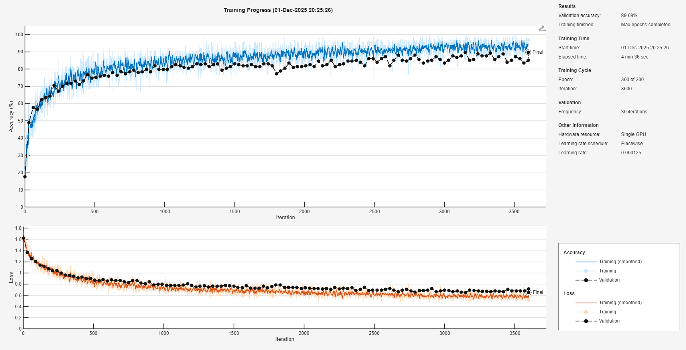
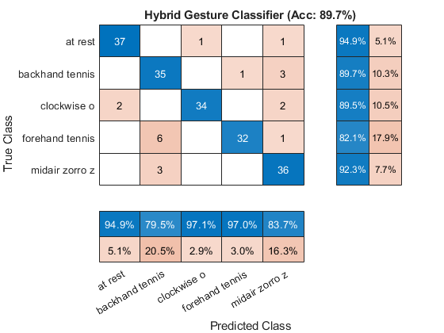
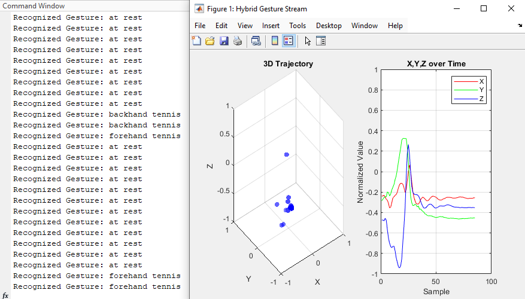

 
## Teaching an Accelerometer to Recognize Gestures
 
Cheap accelerometers are everywhere in wearables, but their signals are noisy and a single model type often struggles with them. For my Intelligent Systems for Engineering term project, I led the design of a hybrid classifier that tries to get the best of two approaches. My teammates were Cubs Domingo and Ahyel Rodriguez.
 
## The idea
 
One branch reads the raw motion signal, and the other reads hand-engineered features:
 
- **Sequence branch:** the raw 3-axis signal goes through batch normalization and two bidirectional LSTM layers of 64 units each.
- **Feature branch:** a vector of 20 statistical features goes through a small feedforward network. The features include signed areas, path lengths, direction reversals, XY curvature, plane bias, and PCA variance ratios.
- **Fusion:** the two outputs are concatenated and passed through a dense layer before the softmax.
I built it in MATLAB with the Deep Learning Toolbox. Training used the Adam optimizer, label smoothing, L2 regularization, and a learning rate that halved every 80 epochs.
 

## The data
 
I trained on the open Makeability Lab dataset, not data I collected myself. I used five classes ("At Rest", "Backhand Tennis", "Clockwise O", "Forehand Tennis", "Midair Zorro Z") with 195 samples each, 975 in total, split 70-15-15 with stratification.

## Offline results

 
The hybrid model reached **89.7% overall accuracy** on held-out data.
 
| Gesture | Accuracy | Precision | Recall | F1 |
| --- | --- | --- | --- | --- |
| At Rest | 0.949 | 0.949 | 0.949 | 0.949 |
| Backhand Tennis | 0.897 | 0.795 | 0.897 | 0.843 |
| Clockwise O | 0.895 | 0.971 | 0.895 | 0.932 |
| Forehand Tennis | 0.821 | 0.970 | 0.821 | 0.889 |
| Midair Zorro Z | 0.923 | 0.837 | 0.923 | 0.878 |
 
Accuracy alone would have hidden the main weakness, which the confusion matrix made obvious. Forehand and Backhand Tennis have similar motion shapes, and 6 of the 39 Forehand samples were labeled Backhand. The model captured timing well but still struggled with overlapping trajectories that differ mainly in direction.
 
## The real-time reality check
 

I then built a live test: an Arduino Uno streaming accelerometer data at 90 Hz over serial to a MATLAB script. The script used a 128-sample sliding window and a motion threshold, so classification only ran when the signal's standard deviation passed 0.05.
{/* TODO: confirm sensor part number (ADXL355 vs ADXL335) before publishing */}
 
| Gesture | Correct (of 10) |
| --- | --- |
| At Rest | 10 |
| Backhand Tennis | 8 |
| Clockwise O | 8 |
| Forehand Tennis | 9 |
| Midair Zorro Z | 0 |
 
Overall that is 35 of 50 correct, or **70%**, down from 89.7%. "Midair Zorro Z" was never detected.
 
## What I took from it
 
The model was not the problem. The offline data was already segmented into clean, gesture-sized chunks, while live data is a continuous stream. My fixed window and simple motion threshold likely cut off or missed complex, high-energy gestures. A strong validation score told me the model could classify a clean gesture, not that the system could find one in a stream.
 
If I rebuilt it, I would start with dynamic windowing and a better segmentation algorithm, and test on live data from day one.
 