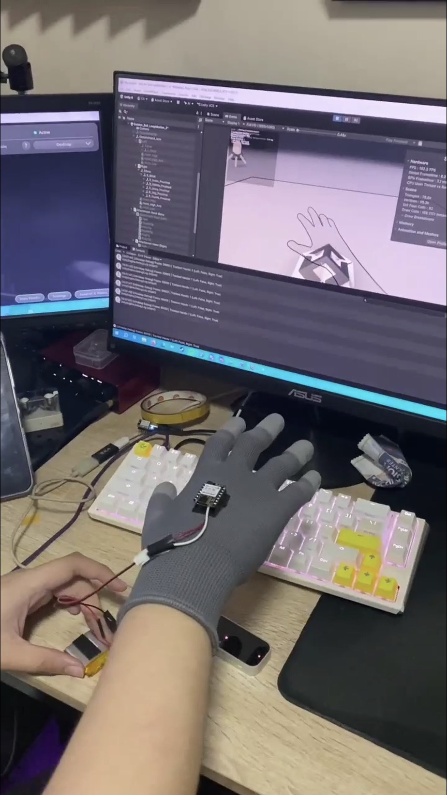

## MIDAS: Letting Visitors Feel Cultural Artifacts

Museums keep their most precious pieces behind glass. That protects them, but it also stops visitors from interacting with them. Virtual and augmented reality can help, and so can wearable haptics, but combining touch feedback with a projected 3D display is still underexplored.

My senior thesis, with Cubs Domingo and Ahyel Rodriguez, tackles that gap. It is called MIDAS (Multi-Modal Interactive Display and Actuated System), and this post covers where it stands.

## The concept

MIDAS pairs two things:

- **Portalgraph**, a Unity-based projected 3D display that shifts its view with the viewer's perspective, resembling a CAVE-style setup without the heavy equipment.
- **A vibrotactile haptic glove**, which turns the texture of a virtual object into vibration patterns when your virtual hand touches it.

Since there is no headset, a group of visitors can stand around the display together, which suits communal learning.

## Objectives

The proposal sets one general objective and five specific ones:

1. Design a vibrotactile glove that provides actuated feedback
2. Build the projected 3D environment in Portalgraph
3. Integrate the glove with Portalgraph, including collision detection and texture-to-vibration mapping
4. Measure glove feedback latency against a **50 ms benchmark**
5. Evaluate effectiveness for cultural heritage exploration using HCI measures and the System Usability Scale

## Why 50 ms

Touch feedback that arrives late breaks the illusion that the virtual object is solid. The 50 ms target comes from the latency literature the proposal cites. To check it, the plan includes an automated test rig that records trigger-to-actuation timestamps, logs telemetry to CSV, and plots the latency distribution against the benchmark with statistical tests.

## Progress so far

I have built and hardware-tested a 2.4 GHz wireless link on nRF52840 radios using Enhanced ShockBurst at 2 Mbps. It streams the orientation of two gloves to a single USB receiver, with per-glove addressing, auto-ACK, and staggered retries. I designed a compact 10-byte packet carrying the hand ID, a sequence number, and an int16 quaternion, with event-driven transmission.
{/* TODO: the proposal names an ESP32 as the glove-to-Unity bridge; mention if and why the radio link moved to nRF52840 */}

## What's next

The remaining work covers the vibrotactile actuators, collision detection and texture mapping in Unity, the latency rig, and user testing. I'll post updates as each piece comes together.