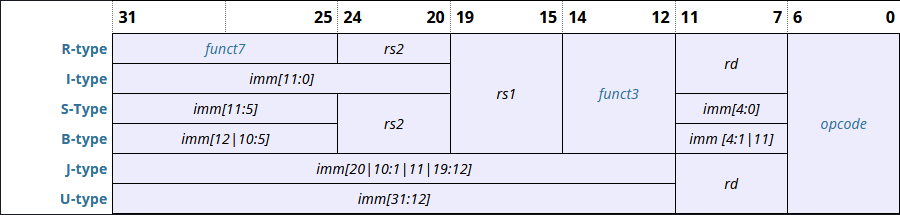
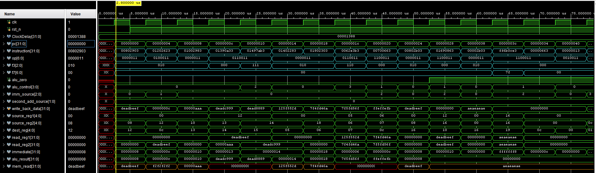

## Building a RISC-V Single-Cycle CPU in Verilog
 
For my Computer Architecture and Organization Laboratory project, I led the adaptation and verification of a 32-bit single-cycle processor for the open RISC-V RV32I base instruction set. Our design is based on the open-source Holy Core course, whose reference core is written in SystemVerilog and tested with Python's cocotb, and we rebuilt it in Verilog for Vivado. I worked with Ethan Beleno, Cubs Domingo, Patrice Itchon, and Ahyel Rodriguez.
 
## Why single-cycle
 
In a single-cycle design every instruction finishes in one clock, so the CPI is always 1. There are no pipeline hazards to manage, which makes the design easy to reason about. The cost is speed, because the clock must be slow enough for the longest instruction path. We chose clarity over performance since the goal was learning.
 
## The architecture
 
The CPU is a Harvard design, with separate instruction and data memories, written in 12 Verilog files:
 
- program counter, with a mux for branches and jumps
- instruction and data memory (parameterized by word count, 128 by default)
- 32x32 register file
- sign extender
- ALU
- control unit, split into a main decoder, an ALU control, and a PC-source control that decodes all six branch conditions (BEQ, BNE, BLT, BGE, BLTU, BGEU) from funct3
- load-store decoder and reader, added last to support byte and half-word access
I built bottom-up. Each component got its own testbench before I wired them into a top-level datapath. The design is based on the Holy Core course's SystemVerilog and cocotb code, along with lectures and the Harris RISC-V textbook. I adapted it into Verilog-2001 for Vivado 2022.2. The overall architecture follows the course, which walks through each component step by step.
 
## Covering the RV32I base instructions

 
Many student CPU projects implement a subset of RV32I. We implemented the 37 computational, memory, and control-flow instructions of the RV32I base set across all six formats (R, I, S, B, J, and U). FENCE, ECALL, and EBREAK are not implemented, and their opcodes fall through to the decoder's default case, which writes nothing and does not branch. The last features I added were byte and half-word loads and stores, since until then the CPU handled only word-aligned data.
 
## Verification

 
I tested at two levels: unit tests per component, and a full-datapath testbench, a Verilog version adapted from the course's cocotb tests, that ran an assembly test program against a prepared data memory. A second testbench produced waveforms, so I could confirm that the decoded opcode, funct3, and funct7 matched the control signals at each clock.
 
**The datapath testbench passed 35 of 40 assertions.** The failures were all reg_write checks on invalid funct7 encodings, where the testbench expected the write-enable to be 0. Because the same checks reported the register as unchanged, we believe the cause is timing in how the testbench samples the signal, not a logic fault in the CPU. All arithmetic, logic, memory, and control-flow instruction tests passed. The unsigned branch tests (BLTU and BGEU) used operands whose signed and unsigned orderings differ, so they confirm the unsigned comparison is distinct from the signed one.
 
## What I would do next
 
- Fix the testbench sampling so those checks are reliable
- Move the design onto an FPGA board to validate beyond simulation
- Build a pipelined version with hazard detection, forwarding, and branch prediction