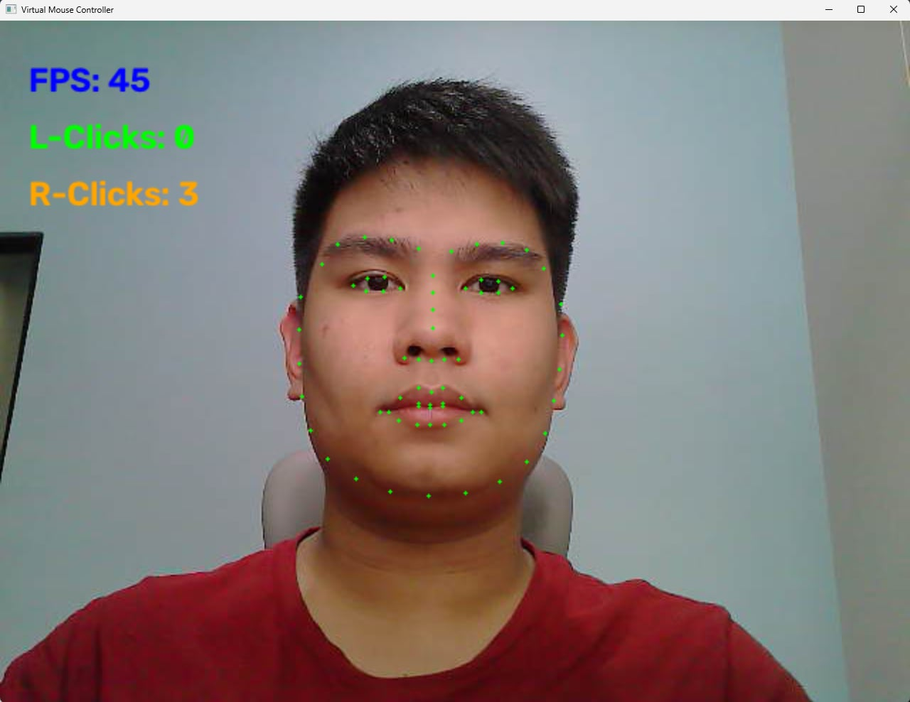

 
## Controlling a Mouse with Your Face
 
Mice and keyboards assume you can use your hands. For people with strain injuries or motor impairments, that assumption is a barrier. This project, which I conducted with Cubs Domingo and Ahyel Rodriguez and which was accepted at HNICEM 2026, asks how far a plain laptop webcam can go as a replacement.
 
The paper has two parts: a qualitative review of related systems (eye-gaze assistive tools, driver monitoring, and AR face tracking) and a working Python implementation.
 
## How it works
 

1. **Capture and detect.** Webcam frames at 640x480 are converted to grayscale and run through a Haar cascade face detector.
2. **Landmarks.** A Local Binary Features (LBF) regressor produces 68 facial landmarks.
3. **Cursor.** The nose tip (point 30) drives the cursor. An exponential moving average with alpha 0.5 smooths out head tremor: `S_t = alpha * X_t + (1 - alpha) * S_(t-1)`.
4. **Clicks.** Left and right winks map to left and right clicks. A click registers only after 2 consecutive frames, which filters out involuntary blinks.
5. **Scroll.** Opening the mouth past a normalized threshold of 0.08 freezes the cursor and scrolls according to vertical head movement. PyAutoGUI sends the system events.

## The design decision that mattered

 
Our first approach used fixed distance thresholds to decide whether an eye was closed. It failed as soon as the user moved closer or farther from the camera. We switched to a relative ratio instead: a wink registers when one eye's opening falls below 75% of the other's. This does not depend on the absolute distance to the camera.
 
| Metric | Fixed threshold | Relative ratio |
| --- | --- | --- |
| Natural blink rejection | 62.4% | 98.6% |
| Left/right wink distinction | 71.0% | 96.2% |
| Distance sensitivity | Fails beyond 60 cm | Stable from 30 to 90 cm |
| Calibration | Manual, per user | None |
 
The system also held at least 30 FPS on a standard laptop CPU. We checked click behavior with an online mouse tester, which showed no double-click faults.
 
## Honest limitations
 
- **Lighting and pose.** Low light and head tilt degrade landmark tracking.
- **Face diversity.** Landmark models trained on narrow datasets can be less reliable across skin tones, facial hair, and face shapes.
- **Fatigue.** Prolonged use can tire the neck, and the mouth-open scroll toggle felt awkward even when it worked.
- **Privacy.** Since the system processes faces live, frames should live only in memory and never be stored.
## What's next
 
The most useful next steps are 3D pose estimation for tilt-based scrolling, better smoothing for fine cursor control, and training on more diverse data.
